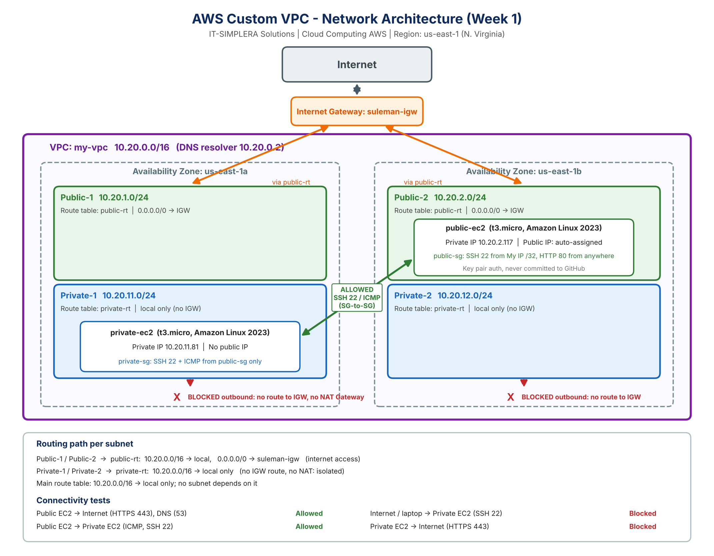

# AWS Week 1: Build a Custom AWS Network

**Course:** IT-SIMPLERA Solutions, Cloud Computing AWS
**Student:** Muhammad Suleman
**Submission date:** 17 November 2026
**Region:** us-east-1 (N. Virginia)

---

## 1. Objective

Design and implement a segmented VPC for a small application that:

- spans **two Availability Zones**,
- separates **internet-facing (public)** resources from **private** workloads,
- uses **controlled routing** and **least-privilege security groups**,
- and proves the design with **allowed and intentionally blocked** connectivity tests.

## 2. Architecture

| Component | Value |
|---|---|
| VPC | `my-vpc`, `10.20.0.0/16` |
| Availability Zones | us-east-1a, us-east-1b |
| Subnets | 2 public + 2 private (one of each per AZ) |
| Internet Gateway | `suleman-igw`, attached to `my-vpc` |
| Route tables | `public-rt`, `private-rt`, plus the VPC main route table |
| NAT Gateway | **Not created** (chargeable, needs instructor approval) |
| EC2 test instances | `public-ec2` (Public-2), `private-ec2` (Private-1), both `t3.micro`, Amazon Linux 2023 |

### Region choice and reason

`us-east-1` was chosen because it is the lowest-cost AWS region with the widest service availability and the most Availability Zones, which suits a short, budget-controlled lab. Latency from Pakistan is acceptable because the lab only needs SSH and simple command-line tests. `ap-south-1` (Mumbai) was considered as the closer alternative.

## 3. Prerequisites

- AWS account with permissions to create VPC and EC2 resources, used through an admin IAM identity rather than the root user.
- Recommended account hardening: MFA on the root user and a billing budget/alert.
- An EC2 key pair (`.pem`), stored **only** on the local machine and never committed.
- Windows PowerShell with the built-in OpenSSH client (or any SSH client).

## 4. CIDR and subnet plan

See [docs/cidr-plan.md](docs/cidr-plan.md). Summary:

| Resource | CIDR | AZ |
|---|---|---|
| VPC `my-vpc` | 10.20.0.0/16 | n/a |
| Public-1 | 10.20.1.0/24 | us-east-1a |
| Public-2 | 10.20.2.0/24 | us-east-1b |
| Private-1 | 10.20.11.0/24 | us-east-1a |
| Private-2 | 10.20.12.0/24 | us-east-1b |

No ranges overlap, and all subnets sit inside the VPC range.

## 5. Routing

See [docs/route-tables.md](docs/route-tables.md). Summary:

| Route table | Routes | Associated subnets |
|---|---|---|
| `public-rt` | `10.20.0.0/16 -> local`, `0.0.0.0/0 -> suleman-igw` | Public-1, Public-2 only |
| `private-rt` | `10.20.0.0/16 -> local` only | Private-1, Private-2 |

The private route table has **no route to the Internet Gateway**, so private instances are isolated from the internet.

### How private instances would get outbound internet (not deployed)

If updates or package downloads were needed, a **NAT Gateway** would be created in a **public subnet** (with an Elastic IP), and `private-rt` would get a route `0.0.0.0/0 -> nat-gateway`. Private instances could then start outbound connections, while inbound connections from the internet would still be impossible. Because a NAT Gateway and its public IPv4 address are chargeable, it is **not created** without instructor approval. Cheaper alternatives are VPC endpoints (for example an S3 gateway endpoint, which is free) or, for patching, a short-lived NAT that is deleted straight after use.

## 6. Security groups

See [docs/security-groups.md](docs/security-groups.md). Summary:

| Security group | Inbound | Purpose |
|---|---|---|
| `public-sg` | SSH 22 from **My IP /32** only; HTTP 80 from `0.0.0.0/0` | Admin access from the student's own IP; HTTP rule reserved for an optional web test (no web service was deployed or tested) |
| `private-sg` | SSH 22 from `public-sg`; ICMP from `public-sg` | Only the public instance (bastion role) can reach the private instance |

SSH is **not** open to `0.0.0.0/0`. Outbound rules are left at the AWS default (all traffic).

## 7. Deployment steps (AWS Console)

1. **Account hardening (recommended):** MFA on root, IAM admin user, billing budget.
2. **VPC:** VPC console, Create VPC, name `my-vpc`, IPv4 CIDR `10.20.0.0/16`.
3. **Subnets:** create Public-1 and Private-1 in us-east-1a, Public-2 and Private-2 in us-east-1b, using the CIDRs above.
4. **Internet Gateway:** create `suleman-igw` and attach it to `my-vpc`.
5. **Public route table:** create `public-rt`, add `0.0.0.0/0 -> suleman-igw`, associate **only** Public-1 and Public-2.
6. **Private route table:** create `private-rt` with only the local route, associate Private-1 and Private-2.
7. **Security groups:** create `public-sg` and `private-sg` with the rules in section 6.
8. **EC2:** launch `public-ec2` in Public-2 (auto-assign public IP on) and `private-ec2` in Private-1 (no public IP), both `t3.micro` with `public-sg` / `private-sg` respectively.
9. **Connect:** use SSH agent forwarding through `public-ec2` to reach `private-ec2` (the private key is never copied to the server).
10. **Test and capture evidence** (section 8), then **clean up** (section 11).

## 8. Connectivity tests and evidence

Full detail in [docs/connectivity-tests.md](docs/connectivity-tests.md).

| # | Source | Destination | Protocol / Port | Expected | Result | Evidence |
|---|---|---|---|---|---|---|
| 1 | Student laptop | `public-ec2` (public IP) | TCP 22 (SSH) | Allowed | **Success**, logged in | `06` |
| 2 | `public-ec2` | `example.com` | TCP 443 (HTTPS) | Allowed | **Success**, HTTP response headers received | `07` |
| 3 | `public-ec2` | `google.com` via VPC DNS `10.20.0.2` | UDP/TCP 53 (DNS) | Allowed | **Success**, name resolved | `07` |
| 4 | `public-ec2` | `private-ec2` (10.20.11.81) | ICMP | Allowed | **Success**, 4/4 replies, 0% loss | `09` |
| 5 | `public-ec2` | `private-ec2` (10.20.11.81) | TCP 22 (SSH) | Allowed | **Success**, logged in | `09` |
| 6 | Student laptop (internet) | `private-ec2` (10.20.11.81) | TCP 22 (SSH) | Blocked | **Blocked**, connection timed out | `11` |
| 7 | `private-ec2` | `example.com` | TCP 443 (HTTPS) | Blocked | **Blocked**, timed out after 10001 ms | `10` |

Screenshots are in [screenshots/](screenshots/):

| File | What it shows |
|---|---|
| `01-vpc-resource-map.png` | VPC `my-vpc` 10.20.0.0/16, 4 subnets across 2 AZs, 3 route tables, Internet Gateway |
| `02-internet-gateway-attached.png` | `suleman-igw` in state **Attached** to `my-vpc` |
| `03-public-route-table-routes.png` | `public-rt`: local route and `0.0.0.0/0 -> Internet Gateway` |
| `04-private-route-table-associations.png` | `private-rt` associated with Private-1 (10.20.11.0/24) and Private-2 (10.20.12.0/24) |
| `05-public-sg-inbound-rules.png` | `public-sg`: SSH restricted to My IP /32 (address hidden) |
| `06-ssh-laptop-to-public-ec2.png` | Test 1: SSH login to `public-ec2` |
| `07-public-ec2-internet-and-dns.png` | Tests 2 and 3: HTTPS response and DNS resolution from `public-ec2` |
| `08-ssh-agent-forwarding.png` | `ssh-agent` started, key added, login with `ssh -A` |
| `09-public-to-private-ping-and-ssh.png` | Tests 4 and 5: ping and SSH from `public-ec2` to `private-ec2` |
| `10-private-to-internet-blocked.png` | Test 7: `curl` from `private-ec2` times out |
| `11-laptop-to-private-ssh-blocked.png` | Test 6: SSH from laptop to private IP times out |

Account ID, account name and the student's public IP address are blacked out in all screenshots.

### Why the blocked tests are blocked

- **Test 6:** `private-ec2` has no public IPv4 address, its subnet route table has no Internet Gateway route, and `private-sg` only accepts SSH from `public-sg`.
- **Test 7:** `private-rt` has only the local route and there is no NAT Gateway, so there is no path to the internet.

## 9. Troubleshooting log

Real issues found while building, and how each was fixed:

| Symptom | Cause | Fix |
|---|---|---|
| EC2 Instance Connect: "Instance is not in public subnet" | Subnet route table had no `0.0.0.0/0 -> Internet Gateway` route / subnet not associated with `public-rt` | Added the IGW route to `public-rt` and associated the public subnets explicitly (see `03`) |
| Console warning: "Port 22 open to all IPv4 addresses" | `public-sg` SSH rule used source `0.0.0.0/0` | Changed the SSH source to **My IP /32** (see `05`) |
| SSH from public to private instance would fail | `private-sg` rule was "Custom TCP, port 0" instead of SSH | Replaced with **SSH 22 from `public-sg`**; test 5 then succeeded |
| `ping -c` and `Start-Service` errors | Linux commands run in Windows PowerShell and the reverse | Ran each command in the correct shell (PowerShell on laptop, bash on EC2) |

### Prepared troubleshooting demo (for the live session)

1. Delete the `0.0.0.0/0 -> suleman-igw` route from `public-rt`.
2. On `public-ec2` run `curl -m 10 https://example.com`: it times out because the subnet has no internet path.
3. Re-add the route and repeat `curl`: it succeeds again.

## 10. Cost and security controls

- Smallest suitable resources only: two `t3.micro` instances; **no NAT Gateway**, no Elastic IPs, no VPC Flow Logs.
- Only the public instance has a public IPv4 address.
- No private keys, access keys, passwords or account identifiers are committed (`.gitignore` blocks `*.pem`).
- SSH is never open to the whole internet.

## 11. Cleanup steps and cleanup record

Run after instructor verification (retain only what the instructor explicitly approves):

| Step | Action | Done |
|---|---|---|
| 1 | Terminate `public-ec2` (`i-0a4bc774031f88ae7`) | [ ] |
| 2 | Terminate `private-ec2` (`i-0db2f13517d41cefd`) | [ ] |
| 3 | Release any Elastic IP (none allocated) | [ ] |
| 4 | Delete NAT Gateway (none created) | [ ] |
| 5 | Optionally delete `public-sg`, `private-sg`, route tables, subnets, detach and delete `suleman-igw`, delete `my-vpc` | [ ] |
| 6 | Delete the key pair `new` from EC2 if no longer needed, and the local `.pem` | [ ] |
| 7 | Confirm in the console that instances show **Terminated** and note the date | [ ] |

Cleanup completed on: ____________________

## 12. Optional challenge (not attempted)

- VPC Flow Logs diagnostic exercise
- Reproducing the VPC with CloudFormation or Terraform

## 13. Submission checklist

- [x] README with objective, architecture, prerequisites, deployment steps, cleanup steps
- [x] Architecture diagram (`architecture-diagram.png`)
- [x] CIDR/subnet plan, route table and security-group explanation (`docs/`)
- [x] Screenshots of VPC, route tables, Internet Gateway and security group (`screenshots/`)
- [x] Connectivity evidence with source, destination, protocol/port and result
- [x] No keys, passwords or account identifiers committed
- [ ] Live demonstration and troubleshooting scenario
- [ ] Cleanup after instructor verification
